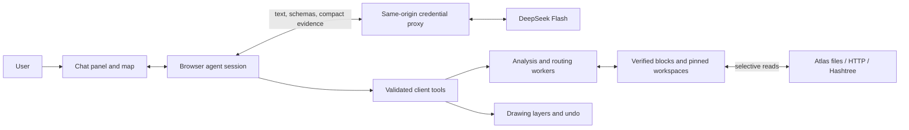

# Atlas chat — browser-owned map intelligence

Implemented 27 October 2026. Open **Chat** in the normal map client. It uses a lazy
assistant-ui React panel, a browser-owned agent loop, an analysis worker, and the
existing Rust/WASM routing worker. The map renderer remains outside React.

## Run it

After the normal local setup, put `DS_API_KEY` in your ignored `.env` (or the client
process environment), then run `bun run dev`. The model is fixed to
`deepseek-flash`. Existing running client processes need restarting after setting
the key; frontend edits need `bun run build:client` and a refresh.

Select compatible maps in **Composer**, open **Chat → Analysis area**, then draw a
rectangle or pin the visible view. The Vienna rehearsal has a **Use Vienna test
area** shortcut. Example requests:

- “Count buildings here with height at least 20 metres. Separate unknown heights
  and distinguish explicit heights from level estimates. Highlight the matches.”
- “Now only those at least 30 metres, using the cached data.”
- “Find Handelskai 300 in Vienna and show it on the map.”
- “Draw a five-minute walking area around that address.”

**Drawings** lists removable layers; each can be fitted or removed independently.
**Stop** aborts the reply and prevents late tool results from changing the map.
Completed drawings remain until undone. **New chat** releases workspaces and result
references. Changing selected sources or data-purpose permissions resets chat so
old work cannot act on a different dataset. References expire after 30 minutes.

A static-only client still supports map operations; chat inference requires the
client server's `/api/chat/*` endpoints. The map host does not need the API key.
The proxy is intended for a local development client, not an unauthenticated
public inference service.

## What executes where



The browser keeps conversation state and dispatches every tool. The proxy only
forwards inference requests to one fixed provider/model. It checks request origin,
limits concurrent requests, bounds request/response sizes, and propagates
cancellation. `DS_API_KEY` never becomes browser configuration or a build define.
Tool execution continues to use the selected `.atlas` files, independent of a
server's operation API. No map geometry is automatically sent to DeepSeek.

“Offline” means cached map operations can run after map providers disconnect;
DeepSeek inference still needs internet. Fully disconnected conversation requires
a local model adapter. A new uncached area fails explicitly in cache-only mode.

## Tool contracts

| Tools | Behavior |
| --- | --- |
| `map_context` | Current viewport, pinned analysis area, enabled purposes, sources and layers |
| `workspace_catalog` | Available retained families, semantics, units and limitations |
| `workspace_prepare` | Selective reads across compatible sources; pins bounded rows and optional geometry |
| `workspace_query` | Typed filters on cached rows; returns a result ID and bounded preview |
| `workspace_result` | Small projected pages; geometry is excluded from model-facing responses |
| `analyze` | Count, numeric statistics including unknowns, scalar grouping, or spatial intersection with one polygon result |
| `search`, `reverse` | Cross-source place/address candidates and nearest retained street; search reports per-source match totals and truncation |
| `route`, `isochrone` | Composed walking/cycling/driving graph computation in WASM; returns a geometry result reference |
| `map_draw` | Resolve shapes locally from a result, or draw bounded authored GeoJSON |
| `map_view`, `map_undo` | Fit or remove the specified drawing/result; source data stays immutable |
| `workspace_release` | Release pinned data and invalidate its result references |

Workspace IDs and result IDs are distinct: to analyze all rows, call
`workspace_query` with only the workspace ID, then pass its **result** ID to
`analyze`. Shared workspace schemas come from the existing operation registry;
chat-only adapters are defined and validated in one table. Provider-facing schemas
translate JSON Schema tuple arrays into a compatible representation, while local
AJV validation retains each coordinate's exact bounds.

Tools execute sequentially, with at most 12 model rounds and 32 tool calls per
reply. SSE parsing preserves fragmented arguments and UTF-8, rejects incomplete
streams, and keeps complete tool-call/result pairs through errors and cancellation.
Source text is treated as evidence, not instructions. No arbitrary JavaScript,
shell, network-fetch or dataset-administration tool is exposed.

## Data and evidence

Preparation uses the existing 0.25-degree maximum span, read/memory budgets,
snapshot compatibility checks, exact boundary intersection and OSM-ID deduplication.
Feature selection retains whole objects touching the boundary; it does not clip
footprints. `geometry:false` saves shape reads for attribute-only work. Drawing or
spatial filtering of those rows requires preparation with `geometry:true`.

Derived analysis runs in a dedicated worker. The main thread brokers byte reads
and persistent-cache access, sharing the existing verified block store with the
map. Cancellation and session revocation gate late responses. Drawing uses separate
bounded overlays: at most eight layers, 10,000 objects per drawing and 32 MiB of
serialized geometry across layers. Geometry result storage has its own 32 MiB cap.
These are payload limits, not a promise about total browser RSS.

Results retain snapshots, coverage and expiry. Complete means complete within
retained OSM source data, not real-world completeness. Missing height or
accessibility remains unknown. Building levels imply an estimate of 3 m/floor;
isochrones explicitly report their resolution and approximation. Spatial filtering
uses intersection; POIs/addresses use their retained representative points.

Chat displays per-tool local time and logical source bytes, cumulative chat source
reads, model rounds/tokens, and last reply duration. Chat analysis reads are measured
separately from the main map inspector. Logical bytes are not Hashtree wire bytes:
Hashtree can fetch a larger verified chunk than the requested range. There is no
claim of an Earthly speedup without an equivalent workload measurement.

## Vienna acceptance checks

Tested with local `west-paged.atlas` and `east-paged.atlas`, one shared source
snapshot. The running LAN compiler/download was not restarted or deployed over.

Pinned area: `[16.368, 48.198, 16.392, 48.218]`.

| Observation | Result |
| --- | ---: |
| Distinct buildings | 3,260 |
| Tagged height / levels estimate / unknown | 1,408 / 1,467 / 385 |
| Height at least 20 m | 1,511 |
| Height at least 30 m | 512 |
| Cold workspace archive bytes, including footprints | 2,030,359 |
| Workspace memory estimate | 46,566,740 bytes |
| Follow-up query and drawing with providers blocked | 0 new map reads |
| Cross-chunk walking route | 7.31 km; both providers used |

On one visible Chromium run, preparation took about 0.95 s, cached filters 3–5 ms,
and drawing resolution 18–43 ms. The route took about 189 ms including reads/worker
startup, reading about 1.61 MB. A five-minute walking isochrone drew successfully
with a 25 m resolution and an approximate 0.395 km² area. These are local rehearsal
observations, not general performance guarantees.

A live DeepSeek run chose the map tools, reported the counts and unknowns, drew
footprints, reused the pinned data for a follow-up, and resolved Handelskai 300 as
an explicit OSM address. Early live calls exposed a provider schema incompatibility
and confusion between workspace and result references; the schema adapter and tool
guidance now address those. The final live run completed 14 tools with no tool
errors; its first analysis reply took 12.6 s and seven model rounds on this machine.
Model reasoning remains fallible; inspect tool evidence.

Regression coverage includes SSE fragmentation/truncation, argument errors,
cancellation with valid provider history, overlap deduplication, unknown values,
spatial filtering, expired refs, geometry validation and proxy origin/concurrency
rules. The full suite passes 208 tests and TypeScript validation. Browser checks used the real worker, renderer and routing engine with only
the model scripted, then repeated key questions with live inference. They verified
zero-read follow-up drawing, undo, cancellation during a blocked map read, stale
handle rejection, and successful isochrone drawing.

```sh
bun run typecheck
bun test
# Existing paged Vienna rehearsal files; no model/key needed:
bun run verify:chat-pair
# Or pass both paths explicitly:
bun run verify:chat-pair /path/west.atlas /path/east.atlas
```

See [feature paging](FEATURE-PAGING.md) to create the paged rehearsal archives.
The original published legacy chunks still need repacking for dense analysis at
this scope; a browser update alone cannot change their storage layout.

## Next boundaries

- No arbitrary-code sandbox yet. Typed tools cover this slice; a later confined
  worker can expose curated geometry operators with explicit budgets.
- Statistics operate on workspace results. Spatial filtering currently accepts one
  polygon/multipolygon region, e.g. one isochrone band.
- Filtered-result geometry hydration, automatic spatial subdivision, clickable
  answer citations, persistent conversations and standalone model selection remain
  follow-ups. Responses and tool details are available for inspection now.
- Tools can use Hashtree through the existing reader, but this slice's recorded
  browser acceptance test used local HTTP ranges. Hashtree amplification and
  offline-reload measurements remain separate work.
- Drawing is a 2D overlay projected through the current camera. It does not create
  editable source objects or true 3D extrusions.

References: [assistant-ui ExternalStoreRuntime](https://www.assistant-ui.com/docs/runtimes/custom/external-store),
[DeepSeek tool calls](https://api-docs.deepseek.com/guides/tool_calls/).
