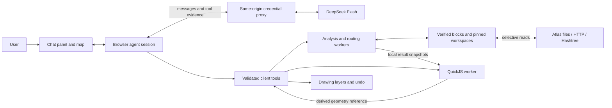

# Atlas chat — browser-owned map intelligence

Open **Chat** in the normal map client. A lazy assistant-ui React panel connects a
browser-owned agent loop to local analysis, QuickJS and Rust/WASM routing workers.
The map renderer remains outside React.

## Run it

Put `DS_API_KEY` in your ignored `.env` or the client process environment, then run
`bun run dev`. The fixed model is `deepseek-flash`. Restart an existing client
process after setting the key or changing the proxy. Frontend edits need
`bun run build:client` and a refresh. The map host does not need the API key.

Select compatible maps in **Composer**, then name the place you want to study in
**Chat**. The camera is not an analysis boundary. **Reference area** optionally pins
a rectangle for requests that explicitly say “here”, “analysis area” or “selected
area”. “Current view” always means the live camera; a named place overrides both.
Follow-ups keep the established task area after panning. With no stated place and
no prior task, the assistant asks which area to use. Try:

- “In the current view, count buildings at least 20 metres tall. Separate unknown heights and level
  estimates, and highlight the matches.”
- “Use JavaScript on the cached results to group building heights into 10 m bands.”
- “Now show only those at least 30 metres, using the cached data.”
- “Find Handelskai 300 in Vienna and draw a five-minute walking area around it.”

**Thinking** shows the provider's streamed reasoning in a collapsible scroller.
Each tool card exposes the exact name, arguments, response, duration and source
bytes. Arguments and responses expand independently. The desktop sidebar is 20%
wider. **Drawings** lists independently removable layers. **Paint the skyline** demonstrates
height classes, unknown values, labels and a map legend. **Export JSON** downloads
an evaluation snapshot of the whole current conversation, even during a reply.

**Stop** aborts model requests and tool work, prevents late map changes, and
terminates a running code worker even during a tight loop. Completed drawings
remain until undone. **New chat** releases cached workspaces, results and drawings.
Changing selected sources or data-purpose permissions resets chat. References do
not expire automatically during a browser chat session.

## What executes where



The browser dispatches every tool. The proxy only forwards inference to the fixed
provider/model, checks origin and keeps `DS_API_KEY` out of browser configuration
and build defines. It is intended for a local demo, not a public inference service.
Model inference needs internet; cached map analysis can continue without map
provider access. A static-only client needs an inference adapter to enable chat.

DeepSeek thinking is enabled. The browser preserves `reasoning_content` on prior
assistant messages when continuing tool exchanges, as required by the provider.
Reasoning text is model output, not proof; inspect actual tool responses.

## Tool contracts

| Tools | Behavior |
| --- | --- |
| `map_context`, `workspace_catalog` | Current view, selection, retained data, sources and limitations |
| `workspace_prepare` | Read selected families across compatible sources and pin rows/optional geometry |
| `workspace_query`, `workspace_result` | Typed cached filters and projected result pages; geometry stays local |
| `analyze` | Count, numeric statistics including unknowns, grouping, or polygon intersection |
| `run_code` | Custom synchronous JavaScript over cached result snapshots in QuickJS |
| `search`, `reverse` | Address/place candidates ranked across all selected maps, optional OSM tag filter before limits, and nearest retained street |
| `place_geometry` | Full retained polygon for a chosen search ID; source footprint, never an invented place extent |
| `route`, `isochrone` | Composed walking/cycling/driving computation in WASM; returns geometry references |
| `map_draw`, `map_style`, `map_view`, `map_undo` | Draw and style locally resolved results, restyle retained geometry, fit or remove layers |
| `workspace_release` | Release pinned rows and invalidate their results |

Workspace IDs and result IDs differ: call `workspace_query` on a workspace first,
then pass its **result** to analysis, drawing or code. Schemas and returned coverage
remain shared with the operation registry. Chat uses the **interactive** workspace
policy; HTTP/ContextVM endpoints retain their separate bounded service policy.

### Code execution

The sandbox adapts Earthly's QuickJS worker design. One worker reuses its compiled
WASM module; each call creates and disposes a fresh runtime/context. Scripts receive
only JSON data and selected helpers, with no `fetch`, DOM, filesystem, imports,
credentials or host evaluation. Stop terminates the worker; the next call recreates
it. Script errors fail the whole output batch before any drawing is applied.

`run_code({ results: [resultId], code })` exposes:

- `data.results[id].rows`: frozen retained rows, including attributes and geometry
  if the workspace was prepared with it; `.meta` retains coverage and provenance.
  Derived geometry results also expose `.collection`.
- `geo.area(feature)` in square metres and `geo.intersects(a, b)` for GeoJSON.
- `console.log/warn/error`: diagnostic lines included in the tool response.
- `emit(featureCollection)`: store derived geometry locally. The tool returns a
  reference that `map_draw` can resolve without sending geometry through the model.
- `return`: a JSON-serializable summary. Execution is synchronous; promises are
  rejected. Script state does not persist; cached result references do.

Example function body (replace `resultId` with the actual reference):

```js
const rows = data.results[resultId].rows;
const tall = rows.filter(row => row.heightMeters != null && row.heightMeters >= 20);
emit({
  type: "FeatureCollection",
  features: tall.map(row => ({
    type: "Feature", id: row.id, geometry: row.geometry,
    properties: { heightMeters: row.heightMeters, heightSource: row.heightSource },
  })),
});
return { total: rows.length, tall: tall.length,
  unknown: rows.filter(row => row.heightMeters == null).length };
```

## Data visualization

`map_draw` accepts a result reference and a portable, declarative `style`. Geometry
stays on the device. `run_code` can derive bins, rankings, grids or normalized values
and emit them as ordinary GeoJSON properties. The renderer reads only explicitly
bound properties; it does not evaluate style scripts or execute source tags.

```json
{
  "result": "geo-result-reference",
  "title": "Building heights · metres",
  "color": "#858c88",
  "style": {
    "colorProperty": "fill",
    "labelProperty": "label",
    "fillOpacity": 0.65,
    "strokeWidth": 0.8,
    "labelSize": 13
  },
  "legend": [
    { "label": "Under 20 m", "color": "#37839a" },
    { "label": "20 m or more", "color": "#be5438" },
    { "label": "Unknown height", "color": "#858c88" }
  ]
}
```

Each feature supplies a six-digit hex `fill` and optional text/number `label` in
this example. Missing colors use the layer fallback; missing labels stay hidden.
Bind `radiusProperty` for proportional markers, or use constant `pointRadius`.
Radii, line widths and label sizes are screen pixels; fill opacity is 0–1.
For circles whose **area** represents a quantity, calculate radius proportional
to its square root. Legends should specify units, class boundaries and unknowns.

For numbered stops, emit Point features with a `stop` property and use
`{ "labelProperty": "stop", "labelPlacement": "center", "pointRadius": 12 }`.
Nearby labels try alternative positions with leader lines. Dense labels may be
hidden until zooming in; geometry is retained. Polygon/line label anchors use
screen bounds and are not entrance locations. Labels have halos; numbered badges
have a contrasting rim. These are camera-projected 2D overlays, not 3D extrusions.

`map_style({ layer, style: { fillOpacity: 0.3, labelSize: 15 } })` changes an
existing drawing with **zero source reads**. Omitted fields remain unchanged;
styles merge, a null property binding clears it, and a supplied legend replaces
the previous one (`[]` removes it). Changing the constant color leaves an active
colorProperty binding in effect; clear that binding to use a uniform color.
Invalid style/feature values fail atomically before a layer changes.

The collapsible map legend is accessible HTML. A layer can contain many colors
and labels, so a tour no longer needs one layer per stop. Its style, legend and
full drawn GeoJSON are included in the conversation export.

## Conversation export for evaluation

**Export JSON** creates a local `atlas-chat-<timestamp>.json` with format
`atlas-chat-conversation`, version `1`. It contains:

- Session ID, timestamps, current state and cumulative turn/round/tool counts.
- User/assistant messages and provider-reported reasoning, including partial text.
- Every recorded tool's ID, name, exact argument string, parsed arguments,
  response/error, start/end times, duration and latest progress message.
- Each turn's exact system context and tool schemas, wire messages, per-model-call
  timing, status and reported token usage. Failed/cancelled calls remain visible.
- Current dataset identities/capabilities, analysis bounds, camera, source-read
  count, and all current drawing layers with GeoJSON, style and legend.

For each round, reconstruct the model request using the turn's `system`, its
`tools`, and the first `inputMessages` of all flattened turn `messages`. History
is stored once rather than copied for every model round. UI messages separately
retain partial streams and tool timings. Totals count recorded operations;
provider usage may be absent for interrupted requests.

The credential proxy's API key and request headers never enter this browser
snapshot. The export does contain the user's conversation and geographic context.
It is an evaluation record, not an importable saved session or an offline Atlas
archive. Undrawn cached source rows are not embedded; result references are local
to the session. Removed drawings remain described in tool history but are absent
from the current layer snapshot. Export before reloading or starting a new chat.

See [creative demo prompts and follow-up tools](AI-CHAT-PROMPTS.md).

## Limits and memory

The demo no longer imposes reply-round/tool-call counts, history trimming,
request/response byte caps, a proxy timeout, workspace read/memory/record budgets,
result-handle counts, or drawing-layer budgets. Model-provider context limits and
actual browser memory still apply. Scripts run until completion, failure or Stop.
Input, coordinate, archive-integrity and capability validation remain in place.
Paging, routing algorithm constraints and cache eviction remain distinct engine
behaviors; removing reply limits does not change those algorithms.

`memoryEstimateBytes` is informational in browser chat. It sums conservative
whole-block decode estimates; it is **not measured browser RSS**. Legacy files can
require decoding a whole cell for a tiny request. The old 64 MiB gate rejected a
small Vienna task before filtering, even with `geometry:false`. Removing that gate
makes existing files usable; paged feature storage still reads and decodes less.

Coverage means retained OSM data, not real-world completeness. Boundary selection
retains whole objects. Missing values remain unknown; levels imply an estimated
3 m/floor. Isochrones report their approximation and resolution. Derived code
results carry the input references and their provenance.

## Verification

The shared-snapshot Vienna pair uses bounds `[16.368,48.198,16.392,48.218]`:

| Check | Result |
| --- | ---: |
| Buildings | 3,260 |
| Tagged height / levels estimate / unknown | 1,408 / 1,467 / 385 |
| Height ≥20 m / ≥30 m | 1,511 / 512 |
| Paged cold source reads including geometry | 2,030,359 bytes |
| Legacy cold source reads including geometry | 4,373,581 bytes |
| Legacy conservative memory estimate | 125,281,135 bytes |
| Cached follow-up query/drawing | 0 source reads |
| Walking / cycling / driving across both chunks | 7.31 / 8.16 / 8.42 km |

Regression tests cover more than 12 rounds/32 tool calls, retained reasoning and
history, legacy-compatible workspace policy, geometry validation, frozen sandbox
inputs, no host API access, fresh script contexts, failed-output atomicity, and
proxy origin checks. Visible-browser checks use real local workers and source
files, including code-generated drawings, expandable traces, a 13-round reply,
Stop during an infinite loop, recovery, and cached operation with map reads blocked.
A live DeepSeek conversation executed six tools, generated both height-filtered
drawings through QuickJS, and completed the ≥30 m follow-up with zero map reads.

```sh
bun run typecheck
bun test
bun run verify:chat-pair
bun run verify:chat-pair data/pair-rehearsal/west.atlas data/pair-rehearsal/east.atlas
```

See [feature paging](FEATURE-PAGING.md) for the newer archive layout. Persistent
conversations, clickable answer citations and automatic
spatial subdivision remain follow-ups. Drawings are 2D overlays projected through
the camera, not editable source features or true 3D extrusions.

References: [assistant-ui](https://www.assistant-ui.com/docs/runtimes/custom/external-store),
[DeepSeek thinking and tool history](https://api-docs.deepseek.com/guides/thinking_mode/).

Visualization/export checks additionally cover zero-valued labels, style fallback
for unknowns, atomic restyling, close-stop label displacement, reconstructable
model inputs, failed argument strings, cancellation, and detached export snapshots.
A browser test paints 3,260 real Vienna building footprints, labels the five
tallest, renders nearby numbered markers and a legend, restyles with provider
reads blocked, and downloads the complete JSON conversation.

The live DeepSeek visualization check completed two turns and nine tools: one
3,260-feature thematic layer, five height labels and a count-bearing legend. It
read 2,030,359 source bytes initially and zero on the opacity/label-size follow-up.
The exported JSON retained ten model rounds, all nine tool traces and the styled
geometry. The model corrected an initial code-level geometry lookup on its own;
this illustrates why keeping intermediate calls and results is useful for evaluation.


## Reusable spatial analysis and linked charts

The browser chat exposes reusable `spatial_*` operations plus result filtering,
summaries, feature inspection, and linked charts. The common pipeline is
`workspace_prepare → workspace_query → spatial_* → result_filter/summary →
chart_show/map_draw`. Cached results preserve source IDs, all retained attributes,
coverage and operation provenance. This works for roads, rails, water, land and
location points as well as buildings; no archive migration is required.

See [the operation reference](SPATIAL-ANALYSIS.md) and
[the expanded prompts](AI-CHAT-PROMPTS.md). Conversation JSON now also contains
current chart data/memberships, chart selection and inspected-feature evidence.
Charts and drawings are ephemeral until exported; chart membership does not add
raw geometry to the model conversation.

`bun run verify:spatial-pair` exercises all six families on the Vienna rehearsal
pair. Its 24,178 rows required 7,338,459 source bytes, followed by zero new reads
for clipping, measurements, water proximity, nearest rail, grids and chart
selection. Of these rows, 6,556 are roads, 408 rails, 18 water, 716 land,
3,260 buildings and 13,220 locations (including addresses, not only POIs).

A visible browser check exercises four chart types, histogram/table selection,
scatterplot brushing, map inspection, JSON export and new-chat cleanup with
subsequent archive reads blocked. A live DeepSeek test measured the roads,
highlighted ten longest segments with labels, then plotted length against nearest
railway distance in a second turn with zero additional source reads. An initial
model geometryType query exposed a query-field mismatch; geometryType is now
supported by both workspace_query and result_filter, with a regression test.

Constructed polygons, distance bands and reusable numeric fields now run in the
chat worker too. See [continuous geometry](CONTINUOUS-GEOMETRY.md) for tool contracts,
accuracy limits and the Danube regression. Reload the client to load the new catalog.

Native styles, explicit exclusion masks, result checks and adjustable cached recipes
are available; see [Analysis recipes](ANALYSIS-RECIPES.md). Running tool progress is
visible when collapsed, and the shared session byte meter includes AI package reads.

## Named-area resolution

Search results contain points, tags and nearby-place context. `search` can filter
by `tag: {key: "leisure", value: "park"}` before candidate limits, avoiding station
and address results crowding out a named park. Composed candidates are ranked as
one union rather than preferring whichever archive was listed first.

`place_geometry({result: searchResult, id: chosenId, family: "land"})` reads the
source feature at its retained search anchor and returns a polygon reference and
its bounding envelope. Prepare that envelope, then use `spatial_filter` against
the polygon for “inside”; its holes remain excluded. The lookup only accepts an
ID from the referenced search result. Point-only places or absent source geometry
return `boundaryAvailable:false`, not an approximate circle. Administrative
boundaries are not generally retained. Ask for clarification or an agreed study
area when the named boundary is unavailable.

No archive rebuild or full-file download is needed for these harness changes.
All spatial computation remains on the device; source pages are fetched as needed.

### Scope acceptance, 27 October 2026

Live DeepSeek/browser tests on the two Vienna rehearsal files, camera at
Schönbrunn, verified:

- “Find cafés” asked for an area with no tool calls or map reads.
- Named Stadtpark analysis resolved the park polygon and counted 289 retained
  benches inside it while keeping the camera at Schönbrunn.
- After panning, a follow-up used the same cached park for a 100 m exterior band,
  with zero new source reads and no new workspace preparation.
- The exact Prater request also resolved retained land geometry independently
  of the camera: relation/1406382 (`landuse=recreation_ground`). It counted 315
  mapped benches inside the polygon and disclosed partial coverage: the park
  extends east to 16.4954°, beyond the rehearsal files’ 16.46° edge. The named
  park search did not return this polygon; discovery required inspecting nearby
  land features. This is an indexing/lookup improvement opportunity, not absence
  of the retained boundary.
- With a reference rectangle pinned and the camera moved, explicit “current
  view” used the new viewport bounds, not the pin. Partial source coverage was
  disclosed. There were no browser page errors in these runs.

These are observed model runs, not a guarantee of every model response. Source
lookup/ranking, filter-before-limit behavior and hole handling have deterministic
regressions. A failed search is not proof of absent source geometry. Parks may
be tagged as recreation grounds rather than `leisure=park`; inspect candidates
and their tags. If no boundary can be resolved, report that rather than fabricate
one. A retained whole polygon does not establish full coverage of its contents.

Large pair acceptance: `bun scripts/verify-large-pair.ts WEST_URL EAST_URL`
checks z0–16/capabilities/shared graph identity, a buildings workspace across the
seam, cached follow-up reads, explicit addresses, named polygons and checked
proximity bands, then all three routing profiles from Vienna to Bratislava. It
uses HTTP ranges and requires both prepared child files, not the shared parent.
