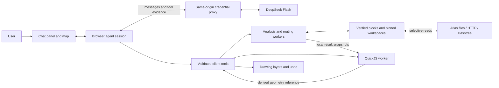

# Atlas chat — browser-owned map intelligence

Open **Chat** in the normal map client. A lazy assistant-ui React panel connects a
browser-owned agent loop to local analysis, QuickJS and Rust/WASM routing workers.
The map renderer remains outside React.

## Run it

Put `DS_API_KEY` in your ignored `.env` or the client process environment, then run
`bun run dev`. The fixed model is `deepseek-flash`. Restart an existing client
process after setting the key or changing the proxy. Frontend edits need
`bun run build:client` and a refresh. The map host does not need the API key.

Select compatible maps in **Composer**, then open **Chat → Analysis area** and
select a rectangle or pin the visible view. The Vienna rehearsal has a **Use
Vienna test area** shortcut. Try:

- “Count buildings at least 20 metres tall. Separate unknown heights and level
  estimates, and highlight the matches.”
- “Use JavaScript on the cached results to group building heights into 10 m bands.”
- “Now show only those at least 30 metres, using the cached data.”
- “Find Handelskai 300 in Vienna and draw a five-minute walking area around it.”

**Thinking** shows the provider's streamed reasoning in a collapsible scroller.
Each tool card exposes the exact name, arguments, response, duration and source
bytes. Arguments and responses expand independently. The desktop sidebar is 20%
wider. **Drawings** lists independently removable layers.

**Stop** aborts model requests and tool work, prevents late map changes, and
terminates a running code worker even during a tight loop. Completed drawings
remain until undone. **New chat** releases cached workspaces, results and drawings.
Changing selected sources or data-purpose permissions resets chat. References do
not expire automatically during a browser chat session.

## What executes where



The browser dispatches every tool. The proxy only forwards inference to the fixed
provider/model, checks origin and keeps `DS_API_KEY` out of browser configuration
and build defines. It is intended for a local demo, not a public inference service.
Model inference needs internet; cached map analysis can continue without map
provider access. A static-only client needs an inference adapter to enable chat.

DeepSeek thinking is enabled. The browser preserves `reasoning_content` on prior
assistant messages when continuing tool exchanges, as required by the provider.
Reasoning text is model output, not proof; inspect actual tool responses.

## Tool contracts

| Tools | Behavior |
| --- | --- |
| `map_context`, `workspace_catalog` | Current view, selection, retained data, sources and limitations |
| `workspace_prepare` | Read selected families across compatible sources and pin rows/optional geometry |
| `workspace_query`, `workspace_result` | Typed cached filters and projected result pages; geometry stays local |
| `analyze` | Count, numeric statistics including unknowns, grouping, or polygon intersection |
| `run_code` | Custom synchronous JavaScript over cached result snapshots in QuickJS |
| `search`, `reverse` | Address/place candidates and nearest retained street; truncation is disclosed |
| `route`, `isochrone` | Composed walking/cycling/driving computation in WASM; returns geometry references |
| `map_draw`, `map_view`, `map_undo` | Draw locally resolved results, fit or remove layers |
| `workspace_release` | Release pinned rows and invalidate their results |

Workspace IDs and result IDs differ: call `workspace_query` on a workspace first,
then pass its **result** to analysis, drawing or code. Schemas and returned coverage
remain shared with the operation registry. Chat uses the **interactive** workspace
policy; HTTP/ContextVM endpoints retain their separate bounded service policy.

### Code execution

The sandbox adapts Earthly's QuickJS worker design. One worker reuses its compiled
WASM module; each call creates and disposes a fresh runtime/context. Scripts receive
only JSON data and selected helpers, with no `fetch`, DOM, filesystem, imports,
credentials or host evaluation. Stop terminates the worker; the next call recreates
it. Script errors fail the whole output batch before any drawing is applied.

`run_code({ results: [resultId], code })` exposes:

- `data.results[id].rows`: frozen retained rows, including attributes and geometry
  if the workspace was prepared with it; `.meta` retains coverage and provenance.
  Derived geometry results also expose `.collection`.
- `geo.area(feature)` in square metres and `geo.intersects(a, b)` for GeoJSON.
- `console.log/warn/error`: diagnostic lines included in the tool response.
- `emit(featureCollection)`: store derived geometry locally. The tool returns a
  reference that `map_draw` can resolve without sending geometry through the model.
- `return`: a JSON-serializable summary. Execution is synchronous; promises are
  rejected. Script state does not persist; cached result references do.

Example function body (replace `resultId` with the actual reference):

```js
const rows = data.results[resultId].rows;
const tall = rows.filter(row => row.heightMeters != null && row.heightMeters >= 20);
emit({
  type: "FeatureCollection",
  features: tall.map(row => ({
    type: "Feature", id: row.id, geometry: row.geometry,
    properties: { heightMeters: row.heightMeters, heightSource: row.heightSource },
  })),
});
return { total: rows.length, tall: tall.length,
  unknown: rows.filter(row => row.heightMeters == null).length };
```

## Limits and memory

The demo no longer imposes reply-round/tool-call counts, history trimming,
request/response byte caps, a proxy timeout, workspace read/memory/record budgets,
result-handle counts, or drawing-layer budgets. Model-provider context limits and
actual browser memory still apply. Scripts run until completion, failure or Stop.
Input, coordinate, archive-integrity and capability validation remain in place.
Paging, routing algorithm constraints and cache eviction remain distinct engine
behaviors; removing reply limits does not change those algorithms.

`memoryEstimateBytes` is informational in browser chat. It sums conservative
whole-block decode estimates; it is **not measured browser RSS**. Legacy files can
require decoding a whole cell for a tiny request. The old 64 MiB gate rejected a
small Vienna task before filtering, even with `geometry:false`. Removing that gate
makes existing files usable; paged feature storage still reads and decodes less.

Coverage means retained OSM data, not real-world completeness. Boundary selection
retains whole objects. Missing values remain unknown; levels imply an estimated
3 m/floor. Isochrones report their approximation and resolution. Derived code
results carry the input references and their provenance.

## Verification

The shared-snapshot Vienna pair uses bounds `[16.368,48.198,16.392,48.218]`:

| Check | Result |
| --- | ---: |
| Buildings | 3,260 |
| Tagged height / levels estimate / unknown | 1,408 / 1,467 / 385 |
| Height ≥20 m / ≥30 m | 1,511 / 512 |
| Paged cold source reads including geometry | 2,030,359 bytes |
| Legacy cold source reads including geometry | 4,373,581 bytes |
| Legacy conservative memory estimate | 125,281,135 bytes |
| Cached follow-up query/drawing | 0 source reads |
| Walking / cycling / driving across both chunks | 7.31 / 8.16 / 8.42 km |

Regression tests cover more than 12 rounds/32 tool calls, retained reasoning and
history, legacy-compatible workspace policy, geometry validation, frozen sandbox
inputs, no host API access, fresh script contexts, failed-output atomicity, and
proxy origin checks. Visible-browser checks use real local workers and source
files, including code-generated drawings, expandable traces, a 13-round reply,
Stop during an infinite loop, recovery, and cached operation with map reads blocked.
A live DeepSeek conversation executed six tools, generated both height-filtered
drawings through QuickJS, and completed the ≥30 m follow-up with zero map reads.

```sh
bun run typecheck
bun test
bun run verify:chat-pair
bun run verify:chat-pair data/pair-rehearsal/west.atlas data/pair-rehearsal/east.atlas
```

See [feature paging](FEATURE-PAGING.md) for the newer archive layout. Persistent
conversations, additional geo helpers, clickable answer citations and automatic
spatial subdivision remain follow-ups. Drawings are 2D overlays projected through
the camera, not editable source features or true 3D extrusions.

References: [assistant-ui](https://www.assistant-ui.com/docs/runtimes/custom/external-store),
[DeepSeek thinking and tool history](https://api-docs.deepseek.com/guides/thinking_mode/).
