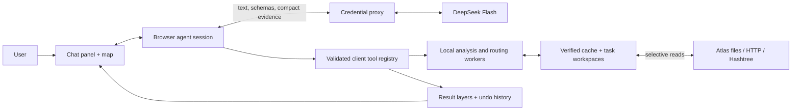

# Atlas chat demo — client-owned map intelligence

Status: design proposal, 27 October 2026. Feature paging is implemented; this document
specifies the chat slice. No chat panel or agent loop is installed yet.

## The claim we will demonstrate

The browser discovers compatible `.atlas` sources, reads the parts relevant to a
question, pins a task workspace, performs analysis locally, and draws the results.
The model receives compact evidence and opaque references. Bulk map geometry stays in
the browser; model context contains only bounded evidence, anchors and references.

DeepSeek Flash is remote inference. Chat state, the tool loop, geospatial tools,
result handles, drawing, cancellation and caching belong to the client. A small
same-origin credential proxy forwards inference requests to DeepSeek; it performs
no map queries. `DS_API_KEY` stays in the local/server environment and is never a
Bun browser build define, browser config value, static asset, or committed secret.
The model ID can be fixed to `deepseek-flash` for this demo.

"Offline" in this demo means the map data providers can disconnect after the
needed data is cached. DeepSeek still needs a connection. Fully disconnected chat
would require a local inference provider, which is a later independent adapter.

## What to reuse from Earthly

Read: `/Users/schlaus/workspace/earthly/docs/architecture/chat.md` and
`src/features/chat/{tools,requestContext.ts,sandbox,safeEditing}`.
Earthly already runs a client-side agent. The improvement here comes from the data
format and local execution contract, not from moving an already local loop.

Reuse the *patterns* and small transferable modules after checking dependencies:

- One registry owns schemas, validation, handlers and availability. Derive the model
  tool list from live registry state; do not maintain a second handwritten list.
- Capture compact, fresh map context on each user turn. Separate user intent from
  observed source metadata and untrusted OSM text.
- Keep complete assistant/tool-result exchanges and tool-call IDs across streaming,
  retries, cancellation and context trimming. Preserve provider-required reasoning
  fields internally when thinking mode is enabled; do not invent reasoning text.
- Group tool activity in a collapsible progress display; retain timings and bytes.
- Apply drawing changes through a small transactional interface, with undo tied to
  the exact layer/revision. A late result from a cancelled run cannot alter the map.
- Reuse the QuickJS worker design for a later code tool: warm compiled WASM,
  fresh execution context per run, curated geospatial functions, deadline/memory/
  output budgets, no DOM/network/credentials and no unrestricted `eval`.

Do not transplant Earthly's monolithic store, Nostr account/payment workflows,
MapLibre editor or publishing model into Atlas. Earthly's "Atlas" documents are
curated map collections; they are unrelated to this repository's `.atlas` archive.

## Chat UI choice

| Option | What it supplies | Fit here |
| --- | --- | --- |
| assistant-ui | React chat primitives, streaming/tool presentation, thread and cancellation interfaces | Recommended: a lazy React island in the existing TypeScript app; use ExternalStoreRuntime with our browser-owned session |
| AI Elements / shadcn | Copyable presentation components, including tool disclosures | Viable, but its official site currently announces a move to shadcn/ui; check the current installation path before adopting |
| Small custom panel | Full visual control with the existing DOM/CSS stack | Lowest framework cost, but we would own streaming, accessibility, scrolling and tool presentation |

Recommendation: assistant-ui for presentation, with our own `AtlasAgentSession`
behind ExternalStoreRuntime. Keep the existing map/renderer outside React. Disable
any automatic tool executor in the UI runtime when our session owns dispatch, so
each call executes once. Do not enable a hosted chat service or persist conversations
remotely by default. Add React/assistant-ui only with the actual UI slice, not now.

## A small tool vocabulary with deep local operations

These are proposed public contracts, built from existing operation descriptors
where possible. Names marked **existing** already work; the rest are new demo work.

| Tool | Input and output | Execution / status |
| --- | --- | --- |
| `map_context` | Current bounds/camera, selected area/layers, pinned sources and roots, cache summary, limits and available tools | Client; new |
| `workspace_catalog` | Retained families, tags/units, addresses, coverage and limitations | Existing, metadata only |
| `search` / `reverse` | Place/address text or coordinate → bounded candidates with stable IDs | Existing; add composition-wide search/deduplication wrapper (current convenience tools use Tool source) |
| `workspace_prepare` | Area, families, semantic requirements, geometry need and budgets → pinned workspace and completeness | Existing; new `geometry:false` selects attributes with exact boundary checks |
| `workspace_query` | Workspace/result ref plus typed predicates → count, preview and result ref | Existing; repeated local queries need no new source reads |
| `workspace_result` | Result ref, page and fields → bounded evidence | Existing; geometry omitted by default |
| `analyze` | Result refs + typed steps such as group/count, min/max, measure, buffer, intersects, nearest → derived result ref and statistics | New deterministic worker operations; start with aggregates and a spatial filter |
| `route` / `isochrone` | Coordinates or resolved feature anchors, mode and limits → result ref with geometry, metrics, coverage | Existing engines; add result-ref wrappers using composed client routing |
| `map_draw` | Result ref or bounded authored GeoJSON, label and style → layer ref/change ref | New client drawing interface; geometries resolved locally, no coordinate echo through the model |
| `map_view` / `map_undo` | Fit a result/layer, set camera, undo a specific change | New client presentation tools |
| `workspace_release` | Workspace ref → release pinned data/results | Existing |

Do not expose millions of possible questions as millions of tools. Prefer typed
composable operations over rows/results, with installable, versioned operators for
specialized algorithms. The host/client advertises the operators it actually has.
Nostr advertisements describe data and capabilities; they never authorize fetching
and executing arbitrary plugin code.

### Evidence and references

A common tool envelope should carry `resultRef`, count, bounded preview, source
snapshots/Hashtree roots, requested scope, coverage, unknown-field counts, method,
units, execution location, compute time, logical source bytes, actual transfer bytes
and cache reuse. Keep these measurements distinct.

- `complete` means complete within retained source data, not a claim that OSM maps
  every real-world object. Empty, partial, unsupported and unknown are distinct.
- Never treat missing wheelchair/height/address tags as negative evidence.
- Every derived result records its input references and analysis method.
- References are session-scoped, expire/release explicitly, and never turn into
  silently re-evaluated queries against a newer snapshot.
- Stable results can be cited in answers and clicked to highlight the corresponding
  objects. Large row sets and raw GeoJSON never become automatic tool text.
- Result handles from the browser cannot be passed unchanged to a remote ContextVM
  executor. It needs its own workspace or an explicit bounded transfer.

### Geometry on demand

The first demo can request `geometry:true` when a task requires drawing/spatial
analysis, then reuse those pinned shapes. For attribute-only counting/filtering,
use `geometry:false`. This already saves reads for interior candidates.

A later `workspace_materialize` operation should hydrate only the geometries of a
filtered result, with a second explicit read budget and cache-only option. This
requires keeping source/page references per row; it is not implemented yet. Until
then the UI/model must not interpret missing workspace geometry as missing source
geometry or promise drawing from an attribute-only workspace after disconnecting.

## First executable story

Start with the two compatible rehearsal maps and a user-drawn area crossing their
seam. Suggested prompt:

> How many buildings here have a recorded or estimated height of at least 20 m?
> Separate unknown heights, highlight the matching buildings, and draw a walking
> route between these two selected addresses.

1. Capture selection, both pinned datasets and available tools.
2. Prepare `buildings` with geometry because the request includes highlighting;
   retain the height source (`tagged`, `levels-estimate`, `unknown`).
3. Query/count the classes locally, save result references and draw from those refs.
4. Resolve addresses and route with the existing composed routing worker; draw the
   route by reference. Explain source coverage and the height estimation convention.
5. Follow up with "only those above 30 m"; reuse the same workspace with zero map reads.
6. Disable map-provider network access while leaving model inference available;
   repeat cached operations. A new uncached area must produce `missing_blocks`.

Next story: cafés or pharmacies within a 15-minute reachable area, grouping explicit
accessibility tags separately from unknowns. This needs a new spatial filter between
POI results and an isochrone, not just a prompt change. Surface the engine's method
and approximation limits in the result.

## Implementation order and acceptance gates

1. **Done now:** feature paging, separate attributes/geometry, bounded excerpts,
   legacy compatibility, exact intersection and a feature-only repacker.
2. Add a client session/registry adapter and result-layer store with undo; a narrow
   same-origin DeepSeek SSE proxy. Fixed upstream/model, bounded input/output,
   cancellation and request limits; no arbitrary proxy URL or tool execution there.
3. Add assistant-ui as a lazy panel. Validate arguments before dispatch. Initially
   serialize tool calls: the current operation session cancels its previous plugin
   invocation, so naive parallel model calls would cancel each other.
4. Add aggregate/spatial-filter workers and route/isochrone result references.
   Keep source geometry immutable and derived layers removable.
5. Run deterministic scripted model tests and a small live DeepSeek evaluation.
   Only then consider the confined custom-code tool and additional ContextVM hosts.

Acceptance tests must exercise the real browser executors, not mock all tool results:

- Cross-map IDs/counts match direct engine results; unknowns and coverage are correct.
- A reference-driven drawing highlights exactly the selected IDs, with stable undo.
- Identical follow-up queries produce zero map-provider reads (including Hashtree),
  while inference traffic is reported separately.
- Cancelling during streaming, reading or analysis prevents late drawing changes.
- Malformed tool arguments, stale handles and unavailable capabilities yield typed
  recoverable errors. Failed exchanges stay well-formed for the next model round.
- Record map transfer, model bytes/tokens/rounds, tool time, total response time and
  cold/warm cache separately. Compare with Earthly on equivalent data/scope rather
  than presenting a different source or task as a speed comparison.
- Cached geospatial data and runtime overhead have separate budgets. Large geometry
  stays out of model context and geometry-only overlays do not mutate source files.

## Provider and UI references checked

- [DeepSeek first call and current model ID](https://api-docs.deepseek.com/quick_start/agent_integrations/)
- [DeepSeek tool calls](https://api-docs.deepseek.com/guides/tool_calls/)
- [assistant-ui LocalRuntime](https://www.assistant-ui.com/docs/runtimes/custom/local-runtime)
- [assistant-ui ExternalStoreRuntime](https://www.assistant-ui.com/docs/runtimes/custom/external-store)
- [assistant-ui source / MIT license](https://github.com/assistant-ui/assistant-ui)
- [AI Elements tool component / migration notice](https://elements.ai-sdk.dev/components/tool)

The configured DeepSeek connection returned HTTP 200, `model: deepseek-flash` and
an expected synthetic function call in a single smoke request on 27 October 2026.
That checks connection/tool-call compatibility, not map reasoning quality.
