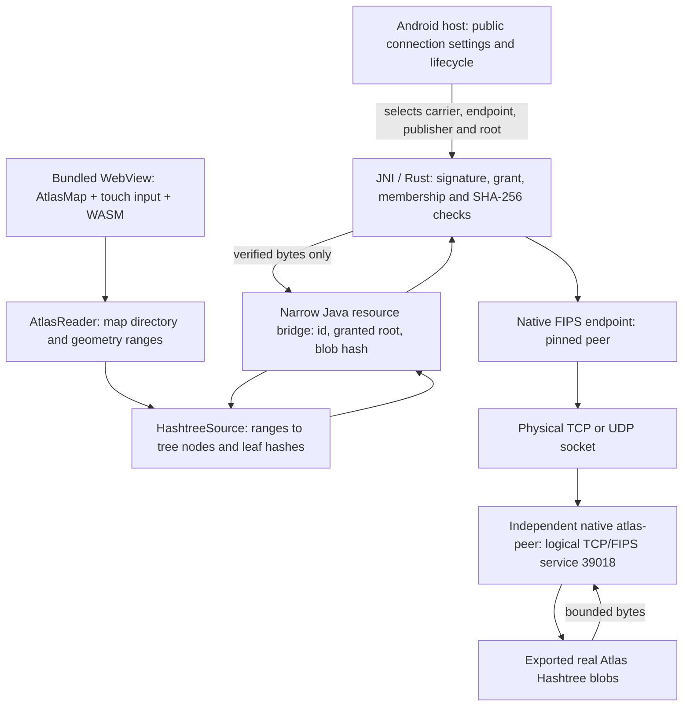

# Android Atlas over native FIPS

The isolated `apps/android` viewer reuses Atlas's map reader, Hashtree range
resolver, Rust/WASM renderer and touch input. Native Rust owns all peer access
and resource authorization. The migration comes from napplet-space
`d00ec1ea657c279c120de2c25f071298d17ecfdc`; that original demo remains intact.

[Build and provider setup](../apps/android/README.md) ·
[Acceptance evidence](../apps/android/VERIFICATION.md) ·
[Production Soyli handoff](SOYLI-FIPS-HANDOFF.md)

## Every hop

The reliable logical **TCP/FIPS** stream runs over the selected physical TCP or
UDP carrier. Choosing UDP really uses a UDP socket; it does not make Atlas reads
unreliable datagrams. The native client checks the connected peer's reported
physical transport and refuses an unexpected carrier.

The provider is a separate Rust process reading an offline snapshot export from
a real `.atlas` file. It does **not** proxy the deployed TypeScript WebSocket
provider. There is no hidden WebSocket, HTTP map/catalog read, DNS dependency,
STUN/TURN, system TUN/VPN or USB data forwarding in this tested path. The existing
production service, builds and files are not changed by the Android module.

The WebView loads `https://atlas.invalid/viewer` solely through an exact local
request interception returning an APK asset. This synthetic URL is not resolved
or fetched. All other WebView requests are denied. JS, CSS and WASM are embedded;
map bytes arrive through JNI, not through a browser fetch.

## Trust and resource contract

1. Native configuration pins the numeric endpoint, carrier, FIPS peer npub,
   publisher key and discovery catalog SHA-256. Only public values are bundled.
2. Native FIPS authenticates the pinned peer. The catalog is downloaded through
   the same native blob protocol and its SHA-256 is verified.
3. Native code validates each kind-30064 event's canonical ID and BIP340 signature,
   publisher, expiry, native peer binding, root/address binding, bounds, zooms and
   Hashtree descriptor. Duplicate IDs/roots are rejected.
4. The Android host grants one offered root. The configured demo automatically
   grants its first verified map. Page code cannot select peers or grant roots.
5. The page may request only `{id, root, hash}` through the bridge. Initially only
   the granted root is readable. A verified MessagePack file node admits its
   children only after native hash, type, size, depth and fanout validation.
   Unknown hashes, ungranted roots, expired offers, corrupt bytes and malformed
   membership proofs fail before data is delivered to the renderer.
6. AtlasReader opens the verified package directory; its snapshot must match the
   signed offer. It is configured for purpose `map` only, with labels disabled.
   Routing/search/extraction are not loaded by startup.

The root grant permits that file's verified descendants. Geometry-only is the
trusted renderer's purpose policy, not a native per-family byte-access ACL. This
standalone app is not a general napplet host and makes no new SDK permission.

**Discovery is an explicit experimental native profile**, `atlas-native-v1`, with
`native-peer` binding and a hash-pinned signed catalog. It reuses Atlas manifests,
Hashtree trees and the blob wire protocol; it is not a finalized NAP extension or
a drop-in replacement for the browser's provider descriptors. The TypeScript
provider/catalog parsers currently require different transport metadata. No
existing parser is weakened to accept arbitrary native endpoints.

There is no relay subscription, live withdrawal, revision arbitration, signed
default composition or provider failover in this native demo. The catalog expires
in seven days; restarting its provider reuses the catalog while valid and stable
keys keep the peer identity fixed. Expiry or a changed export requires new public
configuration. The existing production browser path remains documented in
[FIPS-HOSTING.md](FIPS-HOSTING.md).

## Host isolation and lifecycle

Only bundled trusted renderer code runs in the WebView. It cannot navigate to
remote pages, load frames/workers, access arbitrary files, use service-worker
networking, or open sockets. A hash-based CSP with `connect-src 'none'` complements
Android's blocked network loads. Text from map manifests goes through
`textContent`. `evaluateJavascript` transports JSON values; it never interpolates
unescaped code from map fields. The design follows Android's
[local-content interception guidance](https://developer.android.com/develop/ui/views/layout/webapps/load-local-content).

The native queue is bounded to 128 requests; blobs to 2 MiB; proof nodes to depth
16/fanout 128 and one million remembered links. Connect/read deadlines are 25
seconds. These are demo resource protections, not limits on the size of the
Atlas file. Verified content is held in a small in-memory Hashtree cache; renderer
meshes and directories have separate budgets. The exporter is intentionally a
simple full offline export, not optimized for multi-hundred-GB provider stores.

Cancel, backgrounding and network replacement revoke the active session and
close its endpoint. Returning or restoring connectivity reconnects with the same
pins. An explicit Disconnect suppresses automatic reconnect. A generation token
and monotonic request IDs prevent old renderer requests from taking over a new
map. Page-level abandoned reads are removed from its waiting set; cancellation
of individual already-queued native blob reads is not yet implemented. Session
cancellation closes all outstanding work.

Diagnostics show actual carrier, pinned identity/settings, signature validation
status, verified payload bytes, blob counts, visible tile counts and errors.
Payload counts exclude FIPS encryption and transport overhead. The provider
releases completed application transfer slots while its transport stack handles
FIN/retransmissions, preventing the earlier eight-stream exhaustion failure.

## Scope still to implement

- Native transport metadata in the shared discovery/resource contract, live
  announcements/withdrawals and standard shell/SDK integration.
- A provider adapter backed by the production host's indexes, or a documented
  mesh ingress path, before claiming native access to that service.
- Multi-provider composition/failover and hoster default views on Android.
- Persistent offline cache, viewport retention across session reconnects,
  per-request native cancellation and sustained high-load measurements.
- Internet/cellular and NAT/firewall acceptance, controlled packet-loss tests,
  long-lived sessions and Android versions other than the tested Pixel.

The viewer proves a real native TCP/UDP map path and reuses Atlas rendering. It
does not claim those remaining capabilities based on the transport demo alone.
