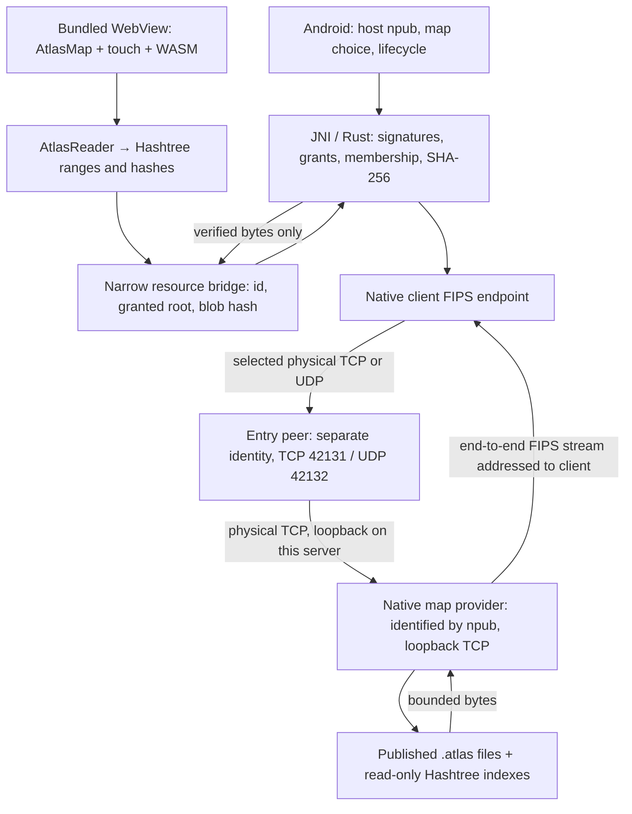

# Android Atlas over native FIPS

The isolated `apps/android` viewer reuses Atlas's map reader, Hashtree range
resolver, Rust/WASM renderer and touch input. Native Rust owns all peer access
and resource authorization. The migration comes from napplet-space
`d00ec1ea657c279c120de2c25f071298d17ecfdc`; that original demo remains intact.

[Build and provider setup](../apps/android/README.md) ·
[Acceptance evidence](../apps/android/VERIFICATION.md) ·
[Production Soyli handoff](SOYLI-FIPS-HANDOFF.md)

## Every hop

The client knows the **map provider's npub**, not its physical address. It first
joins a pinned entry peer, asks FIPS for a route to the provider identity, then
opens reliable TCP/FIPS service 39018 to that identity through the mesh. The
entry peer and map provider are different FIPS nodes and keys. The client
checks the entry link's actual carrier; it never substitutes another transport.

In the deployed demo, the phone-to-entry hop is selectable physical TCP or UDP;
the entry-to-provider hop is **TCP over server loopback**. Thus UDP here describes
the first physical hop, not every link or an unreliable application stream. The
provider listens on 127.0.0.1:42141 and joins the gateway outbound. The phone
cannot directly dial that listener. The gateway only forwards FIPS packets: it
has no Atlas store, catalog signing key, HTTP proxy or blob service.

The original LAN entry and provider run on the same server. The provider now
also joins a public native UDP entry outbound; see [public native hosting](NATIVE-FIPS-HOSTING.md)
for the additional route and exact verification. APK 0.5.0 now defaults to that
public UDP entry, with a LAN-only TCP alternate. A clean Pixel launch over
validated cellular loaded 18/18 real tiles with Wi-Fi disabled. Both public hops
are UDP. The cold load took about eight minutes; performance, public TCP and
failover remain open. A reachable bootstrap is always required underneath npub addressing.

The provider is a separate Rust process using its own persistent native identity
(the existing TypeScript provider has a different identity). With `--host-data`,
it reads existing publication records, SQLite indexes and `.atlas` ranges
read-only, without copying or re-indexing maps. No TypeScript/WebSocket provider,
HTTP map/catalog read, DNS dependency, STUN/TURN, TUN/VPN or USB forwarding is in
this path. The original direct TCP/UDP fixture mode is retained for regression.

The WebView loads `https://atlas.invalid/viewer` solely through an exact local
request interception returning an APK asset. This synthetic URL is not resolved
or fetched. All other WebView requests are denied. JS, CSS and WASM are embedded;
map bytes arrive through JNI, not through a browser fetch.

## Trust and resource contract

1. Native configuration pins the map host npub, carrier and a separate entry
   peer npub/address. Only public values are bundled. Legacy direct profiles
   retain their explicit publisher and catalog-hash pins; mixed profiles fail.
2. Native FIPS authenticates the entry link and routes an end-to-end stream to
   the map host. A well-known signed-catalog request discovers the current library;
   the trusted catalog publisher is derived from that host npub, never supplied
   by the entry peer. No grant is created before signature validation.
3. Native code validates each kind-30064 event's canonical ID and BIP340 signature,
   publisher, expiry, native peer binding, root/address binding, bounds, zooms and
   Hashtree descriptor. Duplicate IDs/roots are rejected.
4. The Android host grants one offered root. The configured demo automatically
   grants the last selected map, or the first verified map. Page code cannot
   select peers or grant roots.
5. The page may request only `{id, root, hash}` through the bridge. Initially only
   the granted root is readable. A verified MessagePack file node admits its
   children only after native hash, type, size, depth and fanout validation.
   Unknown hashes, ungranted roots, expired offers, corrupt bytes and malformed
   membership proofs fail before data is delivered to the renderer.
6. AtlasReader opens the verified package directory; its snapshot must match the
   signed offer. It is configured for purpose `map` only, with labels disabled.
   Routing/search/extraction are not loaded by startup.

The root grant permits that file's verified descendants. Geometry-only is the
trusted renderer's purpose policy, not a native per-family byte-access ACL. This
standalone app is not a general napplet host and makes no new SDK permission.

**Discovery is an explicit experimental native profile**, `atlas-native-v1`, with
`native-peer` binding and a host-identity-signed catalog. The experimental
catalog request is 36 bytes: `48 01 02 00` followed by 32 zero bytes. Ordinary
Hashtree GET remains `48 01 01 00` plus the blob SHA-256. Both use the existing
bounded response framing; catalog signatures authenticate discovery, and
ordinary blob SHA-256 verification is mandatory. The page cannot issue a
catalog request or receive unverified catalog bytes. It reuses Atlas manifests,
Hashtree trees and the blob wire protocol; it is not a finalized NAP extension or
a drop-in replacement for the browser's provider descriptors. The TypeScript
provider/catalog parsers currently require different transport metadata. No
existing parser is weakened to accept arbitrary native endpoints.

There is no relay subscription, client-side live withdrawal processing, revision
arbitration, signed default composition or provider failover in this native demo.
The host-backed provider rechecks publication presence, ready/served status,
snapshot/root identity and the master FIPS switch on each blob read. A withdrawal
therefore denies subsequent reads immediately; it does not erase bytes already
delivered or instantly remove an item from the client's snapshot picker. The
catalog expires in seven days. In npub mode, each new connection requests a
fresh signed catalog of the currently published library, without updating the
APK or changing a catalog hash. Existing sessions keep their snapshot until
reconnect. There is no persisted anti-rollback history across app sessions;
expiry bounds replay, and per-read server checks enforce current publication
policy. Legacy direct fixtures continue using hash-pinned catalog snapshots.
The production browser path remains documented in [FIPS-HOSTING.md](FIPS-HOSTING.md).

## Map and tile selection

The native **Hosted maps** button remains visible after opening a map. Its signed
catalog lists geometry and raster archives; satellite names include the region
from the archive metadata. Selecting a map revokes the previous root grant, closes
its renderer and opens the new verified root. Queued reads for an old root fail
individually, without terminating the replacement session.

**Layers** lists only the selected manifest's display layers. Geometry switches
change both the renderer mask and tile scheduler; imagery switches change the
raster plane's requested keys. The application requests visible tiles at the
current zoom, not an entire archive. Hashtree leaf alignment can include nearby
bytes in a fetched blob, so layer choice is not a per-byte confidentiality claim.
Routing, search, extraction and labels remain off. One archive is selected at a
time; simultaneous Android map composition remains future work.

## Host isolation and lifecycle

Only bundled trusted renderer code runs in the WebView. It cannot navigate to
remote pages, load frames/workers, access arbitrary files, use service-worker
networking, or open sockets. A hash-based CSP with `connect-src 'none'` complements
Android's blocked network loads. Text from map manifests goes through
`textContent`. `evaluateJavascript` transports JSON values; it never interpolates
unescaped code from map fields. The design follows Android's
[local-content interception guidance](https://developer.android.com/develop/ui/views/layout/webapps/load-local-content).

The native queue is bounded to 128 requests; blobs to 2 MiB; proof nodes to depth
16/fanout 128 and one million remembered links. Connect/read deadlines are 25
seconds. These are demo resource protections, not limits on the size of the
Atlas file. Verified content is held in a small in-memory Hashtree cache; renderer
meshes and directories have separate budgets. The optional offline exporter
duplicates bytes. The host-backed adapter instead reads bounded original-file ranges and inline index nodes, verifies every SHA-256
and rejects changed files using the same inode/size/nanosecond fingerprint as the
host. It never opens an index or map for writing.

Cancel, backgrounding and network replacement revoke the active session and
close its endpoint. Returning or restoring connectivity reconnects with the same
pins. An explicit Disconnect suppresses automatic reconnect. A generation token
and monotonic request IDs prevent old renderer requests from taking over a new
map. Page-level abandoned reads are removed from its waiting set; cancellation
of individual already-queued native blob reads is not yet implemented. Session
cancellation closes all outstanding work.

Diagnostics show actual entry carrier, pinned host and entry identities/settings, signature validation
status, verified payload bytes, blob counts, visible tile counts and errors.
Payload counts exclude FIPS encryption and transport overhead. The provider
releases completed application transfer slots while its transport stack handles
FIN/retransmissions, preventing the earlier eight-stream exhaustion failure.

Blob reads use a 90-second bound and one fresh-stream retry on timeout only.
Cancellation and failed verification never retry. Joining and signed discovery
retain a 25-second bound; there is no alternate transport fallback.

## Scope still to implement

- Native transport metadata in the shared discovery/resource contract, live
  announcements/withdrawals and standard shell/SDK integration.
- Multi-provider composition/failover and hoster default views on Android.
- Persistent offline cache, viewport retention across session reconnects,
  per-request native cancellation and sustained high-load measurements.
- Public TCP, additional cellular carriers/NATs, controlled packet-loss tests,
  long-lived sessions and Android versions other than the tested Pixel.

The viewer proves a real native TCP/UDP map path and reuses Atlas rendering. It
does not claim those remaining capabilities based on the transport demo alone.
