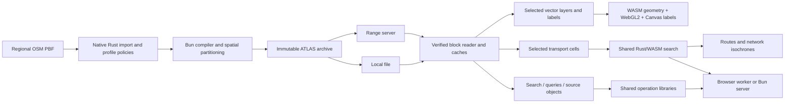

# Prototype architecture

The importer owns OSM meaning and access/speed policies. The compiler owns partitioning, detail, codecs, hashes and capabilities. The reader owns byte acquisition, validation, persistence and explicit offline misses. The renderer owns geometry and presentation; display zoom never controls routing graph detail. The transport core owns snapping, turn-aware time search and approximate reachable-network contours. Operation libraries run on either host; server mode returns results without downloading source graphs to the browser.

The app owns user selection, execution side, capability switches and presentation. Styles, scene/camera state and data subscriptions remain independent. Input uses one active picking owner across tools. Legacy packages remain readable, with explicit capability limits.

This remains a regional prototype: the server pins an archive in RAM, import is memory-based, semantic indexes are partly monolithic, caches outside routing/persistent bytes need bounds, and no routing hierarchy exists. The combined renderer/routing WASM facade and the large map coordinator are the next code-structure seams to improve. See the [measured stack review](STACK-REVIEW.md), [transport contract](ROUTING.md), [wire formats](FORMAT.md), [styling and 3D](STYLING-AND-3D.md), and [planet sizing](PLANET-SIZING.md).
