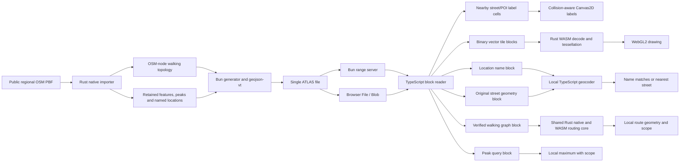

# Prototype architecture

## Boundaries

- Importer owns OSM interpretation. It selects display features, peaks and named location nodes and builds walking topology from original OSM node IDs with an explicit access profile. Flat multipolygon relations are assembled from original node identities, with inner rings assigned as holes and duplicate outer-way fills suppressed.
- Compiler owns spatial partitioning, detail selection, quantization, block hashing, deterministic serialization, and capability declarations.
- Format library owns byte-source abstraction, structural validation, snapshot-consistent fetching, block verification, and cache-only behavior.
- Renderer owns tile decoding, mesh preparation, GPU buffers, and drawing. Its TypeScript wrapper owns camera movement, viewport scheduling, and lightweight 2D overlays.
- Routing core owns validated graph decoding, direction-preserving edge snapping and distance-weighted Dijkstra. It runs in native Rust tests and the same WASM module as the renderer. The separate TypeScript routing library owns lazy graph acquisition and disposal; it returns snapshot-scoped results.
- Geocoder owns local name ranking and segment projection. It lazily loads separate name and street blocks through the same verified reader. Search code is TypeScript in this slice; moving measured bottlenecks to Rust/WASM is possible without changing the public API.
- Map input owns one active picking session. Routing and coordinate lookup cancel the previous session when they take control; click versus drag, Enter and Escape share the same behavior. View zoom (up to 20) is independent of package tile zoom.
- Server owns snapshot-consistent byte delivery and shared operations. Routing, geocoding, peaks, extraction and offline export can execute on this device or on the server; server mode returns results. The regional graph is still loaded as one block, independently of visible tiles.

The app is a consumer of these boundaries. The package can be inspected independently using the CLI and read through either HTTP or a local file.

## Next experiments

1. Extend the implemented layer/region/zoom directory paging to hierarchical binary catalogs and bounded caches.
2. Extend relation coverage to nested/ambiguous areas; add semantic IDs in display tiles, height/attribute columns in display tiles. Source feature picking and uniform-driven styling are now implemented.
3. Partition the walking graph, add spatial snapping indexes and boundary portals, and introduce explicit missing-block search continuations. Keep snapshot and coverage guarantees while loading regions along the search. Add turn rules, richer access profiles and terrain costs separately.
4. Introduce bounded persistent block caches and a Hashtree byte source without changing query or rendering code.
5. Add paged text and spatial search indexes, address points and administrative context, keeping missing-data outcomes separate from no-match results.
6. Benchmark tile codec/compression and Rust WebGPU/native backends against this version using equivalent visual quality.

These are future experiments, not capabilities of this prototype.

## Paint and scene

Data subscriptions, paint documents and camera/scene state are independent. The renderer uses immutable tile geometry with live GPU paint uniforms; building extrusion meshes reuse the same footprints. A shared orthographic transform aligns display, annotations and ground picking. See [Styling and 3D](STYLING-AND-3D.md) for the current contract, limitations and proposed typed expression/layer model, and [Planet sizing](PLANET-SIZING.md) for the scaling work this regional architecture still needs.
