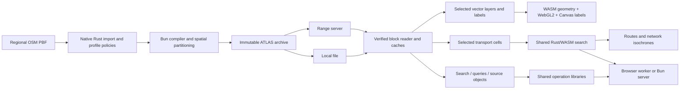

# Prototype architecture

For an intuitive, interactive overview, open the [Atlas field guide](atlas-overview.html)
in a browser. It covers preparation, the archive, discovery, consumers and AI tools.

The importer owns OSM meaning and access/speed policies. The compiler owns partitioning, detail, codecs, hashes and capabilities. The reader owns byte acquisition, validation, persistence and explicit offline misses. The renderer owns geometry and presentation; display zoom never controls routing graph detail. The transport core owns snapping, turn-aware time search and approximate reachable-network contours. Operation libraries run on either host; server mode returns results without downloading source graphs to the browser.

The app owns user selection, execution side, capability switches and presentation. Styles, scene/camera state and data subscriptions remain independent. Input uses one active picking owner across tools. Legacy packages remain readable, with explicit capability limits.

The stack remains a prototype, but preparation now has disk-backed, partitioned stages and paged semantic indexes. The server reads a pinned file handle rather than loading the entire archive into RAM. Rendering and routing have separate WASM facades. Normal network composition uses signed Nostr offers and Hashtree; local files and direct HTTP range APIs remain available. NAS-assisted builds separate sequential payloads from local mutable indexes. Planet-scale throughput is not established, routing has no precomputed hierarchy, and browser memory and large geometry operations still need careful bounds. See [partitioned compilation](PARTITIONED-COMPILER.md), [build storage](BUILD-STORAGE.md), [Hashtree](HASHTREE.md) and [routing federation](ROUTING-FEDERATION.md) for the current contracts. See the [measured stack review](STACK-REVIEW.md), [transport contract](ROUTING.md), [wire formats](FORMAT.md), [styling and 3D](STYLING-AND-3D.md), and [planet sizing](PLANET-SIZING.md).
