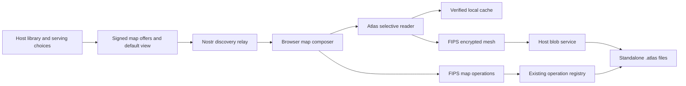

## Shared shell consumer migration — 10 November 2026

The companion `codex/soyli-fips-consumer` change uses ordinary soyLI preview and
the shared shell runtime through the explicit experimental `soy.fips/1` profile.
See [consumer setup, authority and verification](../atlas-consumer/README.md).
Provider configuration, published announcements and active builds are unchanged.
The older preview injection described below is historical, not the normal launch
path or a production standard. No production rollout is included.

# FIPS-first Atlas hosting

An Atlas host does not need a publicly reachable HTTP map origin. Its stable public identities are the publisher's Nostr public key, each immutable Hashtree root, and the FIPS provider's public key.



Discovery, delivery and computation have different jobs:

- **Nostr** publishes signed map capabilities, immutable roots, FIPS provider identities, seed hints and the host's proposed default composition. A client chooses trusted publishers; this is not a global search engine or proof that all maps have been discovered.
- **Hashtree** resolves Atlas byte ranges into hash-addressed blobs. Every blob is verified before use. The root pins the file revision independently of where it is served.
- **FIPS** carries blob reads and operation requests to an authenticated provider over the mesh. The prototype uses WebSocket seeds. The Atlas host itself needs no public DNS name or incoming HTTP port; seed and relay infrastructure can still use DNS.
- **Atlas** determines which display layers and analysis blocks to read. Geometry, labels, routing, search, raster and feature data use the same transport. Rendering and local tools still run on the consumer's device.

## Host controls

The **FIPS** tab shows the provider identity, connected seed peers, all published library roots, transfer counters and relay publication status. It controls FIPS delivery, bootstrap seeds, discovery relays and optional HTTP map delivery. Administration remains on the local/LAN HTTP host console.

FIPS is enabled by default. HTTP data and map-operation endpoints are disabled by default. Turning on HTTP advertises it as another delivery option. A FIPS client does not silently switch to HTTP: its Map panel has an explicit delivery choice and an explicit HTTP fallback permission.

Publishing an already indexed map updates its signed offer without recompiling or duplicating its `.atlas` file. Every served, published library map is available through the provider. Removing or unpublishing a map revokes new reads at that host and publishes a signed withdrawal. Already downloaded bytes cannot be recalled, and other providers may continue serving them.

The library's serving/capability choices still apply. Turning off an operation revokes server computation; it does not remove data already present in a publicly downloadable immutable file. To omit routing or another family from the downloadable data, prepare a package/revision without it. Consumers can independently choose not to read those blocks.

The host can mark a saved composition as its default view. Clients start with it when opening the publisher and may override both presentation and data selection. A view is a recipe referring to roots; it does not change those files.

## Classic host inspection

With **Allow HTTP delivery for direct map inspection** enabled in the FIPS tab,
use **Inspect over HTTP** on a library map, or select maps and choose **Compose
selected maps · HTTP**. These links explicitly set the server address and
`transport=http`; they do not wait for discovery relays or FIPS peers. The
client still reads selective Hashtree blobs and verifies their hashes and the
pinned map snapshot. No rebuild or restart of a preparation job is needed.

**Open over FIPS** and **Compose selected maps · FIPS** remain separate launches
with a publisher and relay hints, and no HTTP fallback. Changing delivery
settings refreshes existing host links. When HTTP is off, only FIPS links appear;
when both are off, map launch links are hidden. Admin downloads and source
retention reports remain available locally under `/admin/maps/`.

The standalone client must also be running (`bun run build:client`, then
`bun run client`). Its offline shell can display an older UI when that process
is stopped. Restart the client and reload before diagnosing map transport.

## Connect a browser

Use the client link in the FIPS tab. It contains a trusted publisher and relay hints rather than a map-server URL, for example:

```text
http://127.0.0.1:5173/?publisher=<64-hex-publisher-key>&relay=wss%3A%2F%2Frelay.example&maps=<map-id>
```

`relay` can be repeated. Without `maps`, the host's signed default view is preferred. Signed offers supply the provider keys and bootstrap seeds. No HTTP catalog request is needed for this launch path. A selected map's identity is `htree://<root>`.

Explicit HTTP use is still supported with `?transport=http`. `?httpFallback=1` permits fallback for data reads when FIPS is selected. It does not authorize replaying a potentially stateful server operation on another provider. Browser files and deliberately local demo servers remain useful without any network discovery services.

Host federation and acquisition can likewise use a relay plus a pinned publisher to discover offers and read/mirror their files through FIPS. Mirroring produces a complete standalone `.atlas` file; FIPS changes delivery, not the file layout.

## Server tools

Port **39018** carries the existing Hashtree TCP blob protocol. Port **39019** carries Atlas operation RPC. These are FIPS service ports, not public TCP firewall ports.

An RPC request pins `{root, path, method, body}`. The server resolves the root only against currently served library maps, then invokes the same operation handlers and policy checks as HTTP. Routing, isochrones, search, extraction, workspace operations and registered custom tools keep their schemas, implementation pins and snapshot checks. Administrative routes are not exposed over RPC.

Responses preserve status and snapshot headers; offline exports can return binary Atlas bytes. Requests are bounded to 64 KiB; existing operation handlers may impose narrower input limits. Responses are bounded to 64 MiB JSON or 256 MiB binary, and operations have a ten-minute transport deadline. Cancelling the caller aborts its stream. Calls are not automatically replayed against another provider, because workspace operations can have state.

## Configuration and migration

On first startup:

| Variable                      | Meaning                                                                                         |
| ----------------------------- | ----------------------------------------------------------------------------------------------- |
| `ATLAS_FIPS_ENABLED=0`        | Disable mesh delivery, for an intentionally offline/local setup                                 |
| `ATLAS_HTTP_DELIVERY=1`       | Enable HTTP data and map operations                                                             |
| `ATLAS_FIPS_KEY_PATH`         | Existing persistent provider identity file; otherwise generated inside the FIPS state directory |
| `ATLAS_FIPS_SEEDS`            | Comma-separated WebSocket seeds                                                                 |
| `ATLAS_DISCOVERY_RELAYS`      | Comma-separated Nostr relays; empty disables relay publication                                  |
| `ATLAS_CLIENT_TRANSPORT=http` | Explicit HTTP default for a locally served client demo                                          |

Host UI choices are persisted in the data directory and take precedence over initial environment defaults. Back up the publisher and provider identity files privately. Never run two providers using the same private identity at once. When replacing the old preview sidecar, stop it before starting the integrated provider with its key.

A deployment can be staged with `bun run deploy --stage-only`. On the server, run the staged release’s `deploy/activate.ts prepare /home/nixuser/atlas 3100` with its Bun runtime to build and smoke-test without switching the live release. Activation still refuses active preparations.

`bun run demo` deliberately configures the standalone local HTTP workflow; FIPS-first production hosting does not require changing the easy offline demo.

## Verification and remaining boundaries

The test suite exercises two root-pinned maps through real FIPS/TCP stacks on an isolated local carrier, selective reads and cache reuse, provider failover, signed relay discovery/withdrawal, optional HTTP, binary RPC, custom operation execution and host revocation. A visible Brave smoke test loaded two signed maps, applied the signed default layer selection, and ran server search through FIPS without HTTP map/catalog requests. The repeatable acceptance setup used a loopback WebSocket mesh. A live deployment check also discovered both Lower Rhine maps from public relays and rendered them through the integrated FIPS provider, and completed a server search in 1.14 seconds. The browser reported zero errors and made zero HTTP map/catalog requests, with HTTP map delivery disabled. Public seed availability and throughput remain external dependencies.

The standalone Atlas browser contains this runtime directly. The Soyli demo napplet also discovers signed offers and composes multiple maps through a temporary trusted-parent bridge using the same FIPS client. It defaults to geometry-only reads, with labels and imagery opt-in. Production napplet.soy/Soyli bridge support is a separate integration; see [the preview consumer](../atlas-consumer/README.md). This does not implement a generic NAP networking API, access-controlled private maps, anonymous discovery, guaranteed relay availability, or automatic replay of stateful operations between providers.

## Live demo deployment — 10 November 2026

The mini PC runs release `20261110T115215681Z-6d4a3512f79f-5fc971c0` (revision `54af0042c2a7`). Its six indexed maps use the existing publisher and provider identities. The old `atlas-fips-preview.service` is stopped and disabled; its identity file is retained and used by the integrated provider. HTTP map delivery is off; LAN administration remains available.

The persisted discovery relays are `wss://relay.primal.net/` and `wss://relay.snort.social/`. Both acknowledged and returned all six signed map offers. The initial relays were unsuitable during this check: Damus intermittently returned HTTP 503 during WebSocket upgrade, and nos.lol accepted a connection but did not acknowledge or return these announcements. Relay choice is configurable in the FIPS tab and does not require restarting a build.

Validation before activation: 474 core tests passed, plus visible Brave checks for signed default views, rendering, server search, zooming, cache purge and reopen without HTTP map/catalog reads. North Sea was paused with approval for activation, then resumed with its saved stages; its unfinished final assembly pass must run again after checkpoint verification.

## Classic inspection recovery — 13 November 2026

The demo host now permits HTTP alongside FIPS. Library actions expose the two
paths separately, including multi-map composition. The browser's FIPS default
and no-fallback policy are unchanged. HTTP inspection consumes the host's signed
announcement response directly; it does not wait for a relay connection.

The host frontend was updated without restarting release
`20261112T093649191Z-b6c9f9fb4a01-6f43c72a` or its running World overview job.
The versioned bundle is `host-inspection-a00d22b78cdc.js`; the prior HTML and
checksums are in `shared/host-ui-backups/a00d22b78cdc/`. A normal subsequent
deployment builds the same changes from source. The local viewer was rebuilt
and restarted on port 5173; its stopped process had left an obsolete offline
shell visible.

Verification: 23 focused host-link, transport and server/client tests passed,
TypeScript checks passed, North Sea rendered and zoomed over HTTP, and Lower
Rhine East/West composed with 18/18 visible tiles and no browser errors. The
same content roots and hash verification are used on both delivery paths.
This check does not certify mesh throughput or repair public FIPS routing.
