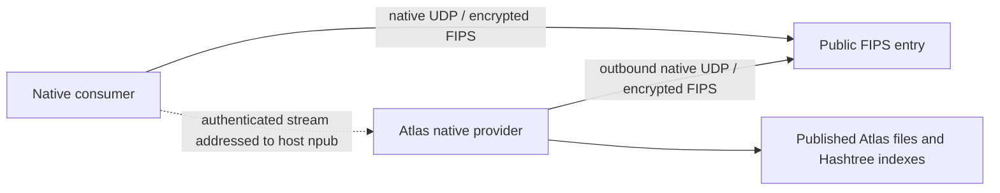

# Public native FIPS map hosting

The native Atlas provider can be reached through a public FIPS entry peer while
remaining behind NAT. The map host needs **no DNS entry, inbound port forwarding,
public HTTP service, VPN or administrator privileges** for this path. Native UDP
is currently verified on the public hop; native TCP is verified on the separate
LAN path. A network that blocks UDP cannot use this public profile. No WebSocket
or HTTP fallback is enabled.

## Deployed path



The two outbound UDP links allow FIPS to carry an end-to-end stream addressed to
the map host's npub. The entry forwards encrypted FIPS traffic, not HTTP map
requests. It does not receive the host identity key or sign its catalog.
Numeric bootstrap addresses are connection hints; pinned keys authenticate them.
The host npub stays stable when an entry is replaced.

The native provider remains a separate read-only sidecar. The TypeScript
provider, its Nostr announcements and WebSocket transit path are unchanged.
The native experimental `atlas-native-v1` catalog has its own signed discovery
contract; it is not a finalized NAP API or full discovery/RPC parity with the
TypeScript provider. See [the native trust boundary](ANDROID-NATIVE-FIPS.md).

## Reproduce

Build `atlas-peer` and `atlas-probe` as described in
[the Android module README](../apps/android/README.md). Keep the existing LAN
entry and provider bootstrap, then copy
[`public-uplinks.example.json`](../apps/android/native/config/public-uplinks.example.json)
to the provider's private state directory. Start the provider with the additional
argument:

```sh
atlas-peer serve tcp 127.0.0.1:42141 127.0.0.1:42141 /srv/atlas-native/state \
  --host-data /srv/atlas/data \
  --bootstrap /srv/atlas-native/state/bootstrap.json \
  --uplinks /srv/atlas-native/state/public-uplinks.json
```

This retains the loopback TCP link to the LAN entry and adds an outbound-only UDP
adapter. The provider remains a leaf, rather than offering arbitrary transit.
Entries must specify a valid npub, numeric endpoint and `tcp` or `udp` carrier.
Unknown fields, duplicate identities, hostnames and alternate transports fail
configuration validation. Up to eight separately pinned entries are supported;
the FIPS core reconnects configured peers. This is not automatic client failover.

Use the host npub from `connection-tcp.json` to make a public consumer profile:

```json
{
  "transport": "udp",
  "peer": "<map host npub>",
  "bootstrap": {
    "peer": "npub1zv3qmj7xz7znehyqwzpc26fcjxtcf7tpxeevxx93ymgm6kw7gjpqp9npvh",
    "address": "65.109.48.91:51820"
  }
}
```

Save it as `public-client-udp.json`, then run:

```sh
atlas-probe "$(cat public-client-udp.json)" 0
atlas-probe "$(cat public-client-udp.json)" 1
```

The positional number selects a signed catalog offer. Each invocation creates an
independent consumer identity. A successful probe validates catalog signatures,
root authorization, descendant membership, SHA-256, an `ATLAS001` header and
repeated immutable reads. Inspect `route.nextHop`: it must be the public entry,
not the map host. Android 0.5.0 now bundles this profile; shared browser/shell
integration remains separate from server rollout.

## Entry provenance and availability

The example pins the second Iris public entry, advertised by the official
[Nostr VPN native bootstrap configuration](https://github.com/mmalmi/nostr-vpn/blob/master/crates/nostr-vpn-core/src/config/types.rs).
Its documented UDP endpoint was resolved once on 11 November 2026 to the numeric
address in the example. Runtime native map access does not resolve DNS.
`nvpn-fips-core` remains pinned at 0.4.95, `nvpn-fips-tcp` at 0.2.5 and
`nvpn-fips-tcp-endpoint` at 0.2.30.

The first advertised entry timed out over native UDP in this verification, so it
is not configured as a working alternate. Public entry availability is an
external dependency; this demo has one verified public entry, not high
availability. A dedicated entry on an operator-controlled public machine can
use the same protocol and identity pinning without assigning DNS to Atlas.
Do not infer that any randomly chosen FIPS implementation/version interoperates.

## Supervision and diagnostics

Run the native provider under a supervisor with `Restart=on-failure`,
`KillSignal=SIGINT`, `UMask=0077`, and its durable state directory. Preserve
`peer-mesh.key`; replacing it changes the map host npub. Never distribute keys.
Only the native provider needs restarting to change uplinks; Atlas map builds
and its administration service need no restart or extra firewall exposure.

`uplinks-status.json` is atomically refreshed approximately every five seconds.
It records the host npub, check time, configured entry, expected and actual
transport, and whether the pinned link is authenticated. Treat stale timestamps
as stale data. Link health is deliberately not an end-to-end readiness claim:
use the probe to verify discovery and map reads. Server-side publication,
served-state, snapshot and master FIPS-switch checks still apply to reads.

## Verification, 11 November 2026

- Native unit tests: 14 passed, including invalid uplink configuration and
  preserved LAN listener/no alternate transport.
- Isolated mesh tests passed: TCP and UDP entry links; signed discovery, grants,
  descendants and repeated reads; corrupt content rejected; wrong entry identity
  and absent provider fail; separate outbound UDP entry coexists with LAN TCP.
- Public route: a Mac native probe used only the public entry address and host
  npub, discovered six real offers, read Lower Rhine East's header and completed
  36 verified blobs / 131,095 payload bytes. This excludes signed catalog bytes
  and network overhead.
- A second independent public session selected Lower Rhine West: 36 verified
  blob reads / 127,993 payload bytes. The retained LAN TCP path also passed
  signed discovery and the East-map probe after activation.
- The server's public-entry link authenticated as native UDP. The provider uses
  the existing native identity and published files; it does not copy maps.

The Android 0.5.0 follow-up also passed physical **cellular/off-LAN** acceptance:
Wi-Fi disabled, validated cellular default route, clean automatic startup,
Lower Rhine East fully rendered (18/18 tiles; 3,542,996 verified payload bytes,
76 hashed blobs). Both phone→entry and entry→provider physical links were UDP.
The cold viewport took about eight minutes; one external entry, variable read
latency and no public TCP fallback remain material limitations. Android now
allows a 90-second blob read and one timeout-only retry, without relaxing any
verification. Its alternate TCP profile is LAN-only. See the
[phone evidence and reproducible test](../apps/android/VERIFICATION.md).
