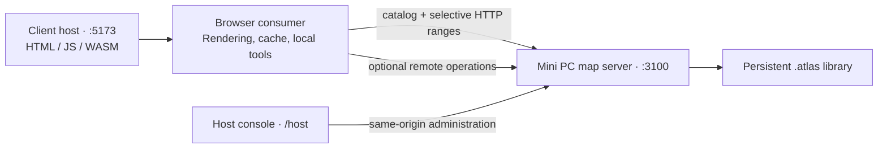

# Independent server and consumer

Atlas now has two executable entry points and two browser builds.

| Part | Source | Build | Responsibility |
| --- | --- | --- | --- |
| Map server | `apps/server/index.ts` | TypeScript run by Bun; Rust native tools/WASM | Atlas storage, catalog, byte ranges, operations, preparation, ContextVM |
| Server's host console | `apps/host/` | `dist/host/` | Administer that server; preview/select areas and prepare maps |
| Consumer demo | `apps/web/` | `dist/client/` | Render/compose maps, run local tools or call remote operations |
| Optional static client server | `apps/web/server.ts` | None | Serve client assets/config only; no map files, operation engine or proxy |

Shared format, rendering, operation and routing libraries remain under `packages/`.
The browser and server still use the same implementations for corresponding tools.
`apps/shared/` holds static-file handling, URL construction and common visual styles.
The host console is part of the server's administration surface, not the consumer app.

## Data flow

During LAN development, `bun run deploy tunnel` exposes the mini PC's port 3100
as `http://127.0.0.1:13100` on the Mac. The browser requests that origin directly
from its separately served client at port 5173. SSH transports those requests;
there is no client-app API proxy or duplicate local map server.

The backend root and `/health` identify `atlas-server`. It serves `/host`, public
`/catalog`, `/maps/...`, `/api/...` and local administration endpoints. Consumer
`/main.js`, `/routing-worker.js`, `/sw.js` and `/compose` return 404 there.
The optional client server identifies `atlas-client` at `/health` and returns 404
for the backend catalog, API, map and administration paths.

## Configuration

| Setting | Where | Default / use |
| --- | --- | --- |
| `ATLAS_SERVER_URL` | Client build or static server | `http://127.0.0.1:13100/`; written to or served as `/client-config.json` |
| `?server=...` | Consumer URL | Overrides configuration; Composer's connection form writes this |
| `ATLAS_CLIENT_URL` | Map server | `http://127.0.0.1:5173/`; destination for host-library links |
| `ATLAS_CORS_ORIGINS` | Map server | `*` for public map consumers; optional comma-separated exact HTTP(S) origins |
| `ATLAS_FILE`, `ATLAS_DATA_DIR` | Map server | Source package and persistent storage; never needed by the consumer |
| `ATLAS_CLIENT_DIR` | Optional static server | `dist/client`; allows serving a separately copied client build |
| `HOST`, `PORT` | Each process independently | Loopback; server 3100 / client 5173 |

Build a portable website with `ATLAS_SERVER_URL=https://maps.example bun run build:client`,
then publish **only `dist/client/`** at an HTTP(S) origin's root. Changing its
`client-config.json` changes the default backend without recompiling JavaScript.
The Bun static server can also override that file with its environment setting.
Paths are root-relative; hosting the consumer below a URL subdirectory is not yet supported.
Use compatible HTTPS origins when deploying publicly; an HTTPS client cannot read
an insecure HTTP map server. Loopback works with the existing secure-context features.

Host links carry `server` and `map`/`maps` parameters into the independent client.
Foreign catalog entries open with their exact `source` and `api` URLs. Relative
catalog addresses resolve against the catalog's origin, not the consumer origin.
A selected catalog API is used explicitly rather than assuming its URL from the file.
Additional hosts and saved composition links keep their existing discovery behavior.

## HTTP boundary

Public CORS covers catalogs, package ranges, capability discovery and operation POSTs.
Preflight permits `Range`, conditional identity headers and JSON content types.
Responses expose strong ETags, Content-Range, snapshot identity and operation metrics,
including on errors. Clients can therefore validate bytes and distinguish a changed
snapshot from a transport failure. CORS is a browser policy, not authentication.

Administration is not exposed by public CORS. Cross-origin admin requests are denied,
and the existing loopback address/hostname and same-origin JSON mutation checks remain.
Use the server's host console via the SSH tunnel. Deployment does not change firewall,
TLS or authentication configuration, or publish Nostr announcements.

## Build and deployment

- `bun run build:client` creates the standalone static consumer.
- `bun run dev` builds and serves that consumer; rebuild after frontend edits.
- `bun run client` serves an already-built consumer.
- `bun run server` builds the host console and starts a local map server.
- `bun run dev:server` also watches backend source changes.
- `bun run build:web` builds both independent browser outputs.
- `bun run deploy` installs the map server and its host console on the mini PC.
  It excludes `apps/web/`, retains stored map data and checks the candidate before switching.

`tests/server-client.test.ts` starts both HTTP applications against a small real Atlas
fixture. It checks the app boundary, range/ETag round trips, cross-origin operation
preflight and result identity, separate client/server data reads, admin isolation,
restricted CORS origins and correct links between the two applications.
