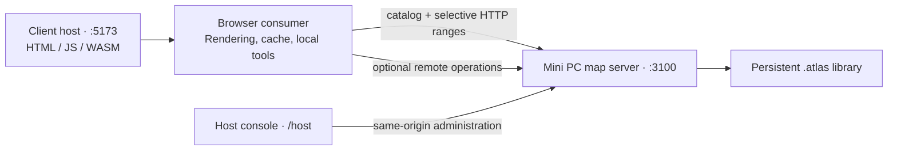

# Independent server and consumer

Atlas now has two executable entry points and two browser builds.

| Part | Source | Build | Responsibility |
| --- | --- | --- | --- |
| Map server | `apps/server/index.ts` | TypeScript run by Bun; Rust native tools/WASM | Atlas storage, catalog, byte ranges, operations, preparation, ContextVM |
| Server's host console | `apps/host/` | `dist/host/` | Administer that server; preview/select areas and prepare maps |
| Consumer demo | `apps/web/` | `dist/client/` | Render/compose maps, run local tools or call remote operations |
| Optional static client server | `apps/web/server.ts` | None | Serve client assets/config only; no map files, operation engine or proxy |

Shared format, rendering, operation and routing libraries remain under `packages/`.
The browser and server still use the same implementations for corresponding tools.
`apps/shared/` holds static-file handling, URL construction and common visual styles.
The host console is part of the server's administration surface, not the consumer app.

## Data flow

The client defaults to `http://127.0.0.1:3100/`. Run `bun run setup` once,
then `bun run demo` to start both applications locally. The host preview uses the
installed Atlas map on fresh installations. No remote map server or relay is
required. Initial dependency/source downloads and the optional OpenFreeMap
preview require internet access.

To use the existing LAN deployment instead, explicitly run
`ATLAS_SERVER_URL=http://192.168.0.179:3100 bun run dev`, or connect to it through
the client composer. `bun run deploy tunnel` remains an optional administration
path. See [deployment setup](DEPLOYMENT.md#lan-firewall-setup).

The backend root and `/health` identify `atlas-server`. It serves `/host`, public
`/catalog`, `/maps/...`, `/api/...` and local administration endpoints. Consumer
`/main.js`, `/routing-worker.js`, `/sw.js` and `/compose` return 404 there.
The optional client server identifies `atlas-client` at `/health` and returns 404
for the backend catalog, API, map and administration paths.

## Configuration

| Setting | Where | Default / use |
| --- | --- | --- |
| `ATLAS_SERVER_URL` | Client build or static server | `http://127.0.0.1:3100/`; written to or served as `/client-config.json` |
| `?server=...` | Consumer URL | Overrides configuration; Composer's connection form writes this |
| `ATLAS_CLIENT_URL` | Map server | `http://127.0.0.1:5173/`; destination for host-library links |
| `ATLAS_CORS_ORIGINS` | Map server | `*` for public map consumers; optional comma-separated exact HTTP(S) origins |
| `ATLAS_FILE`, `ATLAS_DATA_DIR` | Map server | Source package and persistent storage; never needed by the consumer |
| `ATLAS_CLIENT_DIR` | Optional static server | `dist/client`; allows serving a separately copied client build |
| `HOST`, `PORT` | Each process independently | Loopback; server 3100 / client 5173 |

Build a portable website with `ATLAS_SERVER_URL=https://maps.example bun run build:client`,
then publish **only `dist/client/`** at an HTTP(S) origin's root. Changing its
`client-config.json` changes the default backend without recompiling JavaScript.
The Bun static server can also override that file with its environment setting.
Paths are root-relative; hosting the consumer below a URL subdirectory is not yet supported.
Use compatible HTTPS origins when deploying publicly; an HTTPS client cannot read
an insecure HTTP map server. Loopback works with the existing secure-context features.

Host links carry `server` and `map`/`maps` parameters into the independent client.
Foreign catalog entries open with their exact `source` and `api` URLs. Relative
catalog addresses resolve against the catalog's origin, not the consumer origin.
A selected catalog API is used explicitly rather than assuming its URL from the file.
Additional hosts and saved composition links keep their existing discovery behavior.

## HTTP boundary

Public CORS covers catalogs, package ranges, capability discovery and operation POSTs.
Preflight permits `Range`, conditional identity headers and JSON content types.
Responses expose strong ETags, Content-Range, snapshot identity and operation metrics,
including on errors. Clients can therefore validate bytes and distinguish a changed
snapshot from a transport failure. CORS is a browser policy, not authentication.

Administration is not exposed by public CORS. Cross-origin admin requests are denied.
Loopback works by default; optional LAN access requires both an exact origin and
an actual socket peer in a configured subnet. Same-origin JSON is required for mutations.
Forwarded headers never grant administration access. Deployment does not change firewall,
TLS or authentication configuration, or publish Nostr announcements.

## Build and deployment

- `bun run setup` prepares the local sample and builds both apps.
- `bun run demo` builds browser assets and runs both apps on loopback; Ctrl+C stops both.
- `ATLAS_SERVER_PORT` / `ATLAS_CLIENT_PORT` override the demo ports together with its URLs.
- `bun run build:client` creates the standalone static consumer.
- `bun run dev` builds and serves that consumer; rebuild after frontend edits.
- `bun run client` serves an already-built consumer.
- `bun run server` builds the host console and starts a local map server.
- `bun run dev:server` also watches backend source changes.
- `bun run build:web` builds both independent browser outputs.
- `bun run deploy` installs the map server and its host console on the mini PC.
  It excludes `apps/web/`, retains stored map data and checks the candidate before switching.

`tests/server-client.test.ts` starts both HTTP applications against a small real Atlas
fixture. It checks the app boundary, range/ETag round trips, cross-origin operation
preflight and result identity, separate client/server data reads, admin isolation,
restricted CORS origins and correct links between the two applications.

## Initial split verification — 2026-10-10

The split was deployed to the HM90S with all existing map files retained. Its
systemd service runs the backend on port 3100, reached from the Mac through 13100.
The Mac's separate client process serves only static assets on 5173.

Browser checks against the actual remote server confirmed:

- All four prepared regional maps rendered together, with 206 range reads.
- A search for Stephansplatz in Vienna & Lower Austria ran on the server:
  1,113 ms reported and 1.7 KB returned; client search payload reads remained zero.
- The host library opened its Vienna map at the client origin with the backend
  address and map identity preserved.
- The Vienna Plus walking example, Stephansplatz → Praterstern, ran on the server:
  2.06 km, about 26 minutes, 124 ms reported and 6.8 KB returned. The server read
  three routing cells (0.56 MB); the client received the route, not the graph.
- No browser console errors were reported on the successful route page.

These are functional checks and individual observations, not a performance benchmark.
TypeScript validation and all 122 Bun tests passed, including five new split-boundary
integration tests. Deployment's native Linux build and candidate smoke checks passed.

## Direct LAN verification — 2026-10-10

After the LAN-only firewall module was applied, the client was rebuilt and its
saved composition reconnected directly to `http://192.168.0.179:3100/`.

- The direct health endpoint and a 32-byte HTTP range returned 200 and 206
  respectively, including the expected CORS and package identity headers.
- The browser discovered five maps and rendered the four selected regional maps:
  23 of 23 visible tiles ready, 4.51 MB read, WASM renderer active.
- A server search for Stephansplatz in Vienna & Lower Austria returned 15 matches
  (eight displayed), reporting 1,099 ms and 1.7 KB returned.
- The successful browser session reported no console errors.

These measurements are individual functional observations, not benchmarks. The
client default, catalog, map URLs and tool source all use the LAN origin; the SSH
tunnel is only an optional path to the still-local-only administration console.
The client build, TypeScript validation and installer shell syntax check passed.

## Trusted LAN host console

The HM90S sets `ATLAS_ADMIN_ORIGINS=http://192.168.0.179:3100` and
`ATLAS_ADMIN_SUBNETS=192.168.0.0/24` in its persistent `shared/server.env`.
This explicitly trusts clients on that LAN; it is not user authentication or a
public-hosting access scheme. The firewall also restricts port 3100 to Ethernet
and that subnet. The host console now works directly at
`http://192.168.0.179:3100/host`. Missing permission produces an access message
instead of leaving sections in a loading state.

Unset both variables to restore local-only administration. Configure authenticated
HTTPS before exposing administration beyond a trusted LAN. Public map consumers
remain independent of administration permissions.
